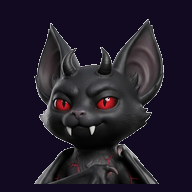
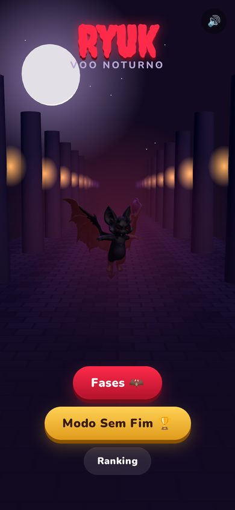
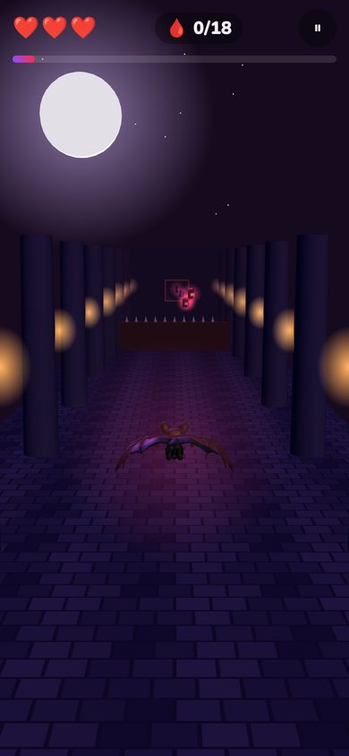
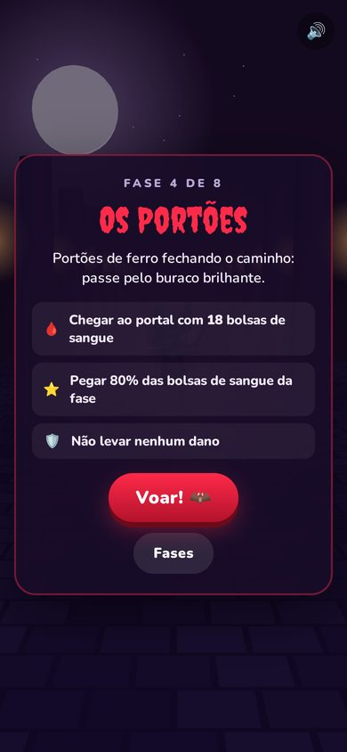
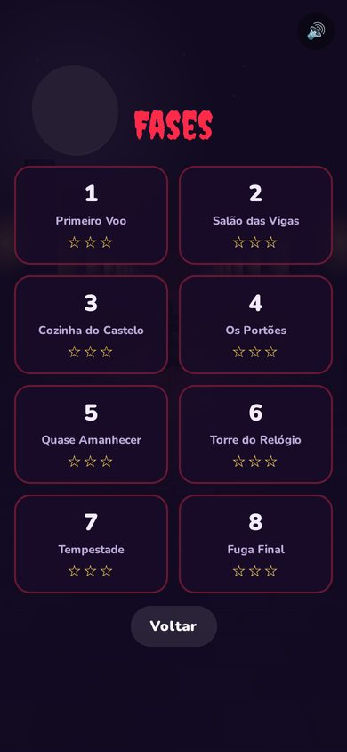
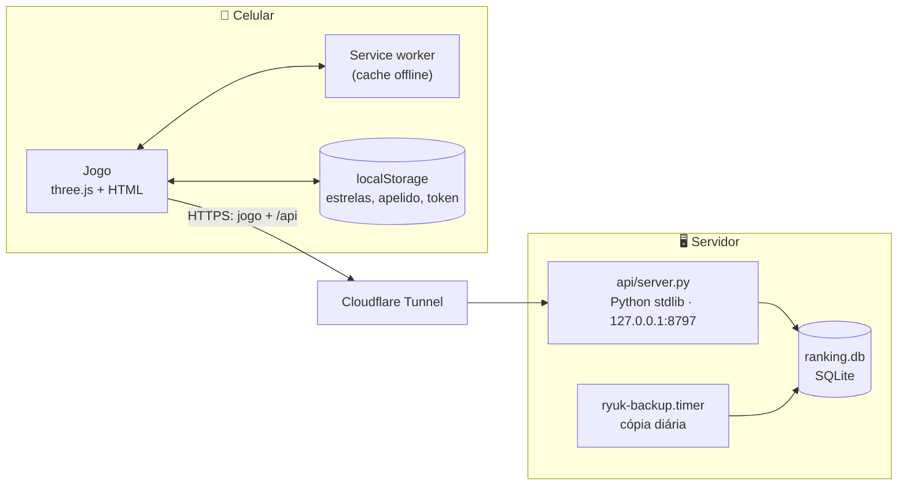

<div align="center">
  

  <h1>Ryuk: Voo Noturno</h1>

  <p><strong>Um morceguinho vampiro voando por um castelo gótico — inventado por uma filha, transformado em jogo pelo pai.</strong></p>

  <p>
    <a href="https://ryuk.gab.dev.br"></a>
    
    
    
    
    
  </p>

  <p>
    <a href="https://ryuk.gab.dev.br"><strong>🦇 Jogar agora</strong></a> ·
    <a href="#a-história">A história</a> ·
    <a href="#como-jogar">Como jogar</a> ·
    <a href="#rodar-localmente">Rodar localmente</a> ·
    <a href="docs/COMO-FOI-FEITO.md">Como foi feito</a>
  </p>

  <br />

  
  
  
  
</div>

<br />

> [!NOTE]
> **Um projeto de pai e filha.** A Isa criou o Ryuk — nome, cara, chifres, presas, o rabo com ponta de
> coração. O pai transformou o desenho em modelo 3D, em jogo e em app, e os dois foram decidindo
> juntos, pedido por pedido, o que o jogo precisava ter.

## Conteúdo

- [A história](#a-história)
- [Recursos](#recursos)
- [Como jogar](#como-jogar)
- [Instalar no celular](#instalar-no-celular)
- [Rodar localmente](#rodar-localmente)
- [Arquitetura](#arquitetura)
- [Estrutura do repositório](#estrutura-do-repositório)
- [Documentação](#documentação)
- [Contribuindo](#contribuindo)
- [Licença](#licença)
- [Agradecimentos](#agradecimentos)

## A história

Num domingo à tarde, a Isa conversou com o ChatGPT até o personagem ficar do jeito dela e pediu um
prompt "pro meu pai passar pro Meshy". O resto foi uma sequência de pedidos, um por vez:

| | Pedido | O que virou |
|---|---|---|
| 1 | "Gera o modelo 3D dele" | Imagem de referência → modelo 3D com textura ([Meshy](https://www.meshy.ai)) |
| 2 | "Um jogo de passar de fases" | 8 fases num castelo, com desafios e estrelas |
| 3 | "Um ranking pra mandar pros amigos" | Modo Sem Fim + ranking com apelido único |
| 4 | "Tem que bater asas e voar na horizontal" | Modelo novo de asas abertas + asa animada no shader |
| 5 | "Troca as almas por bolsas de sangue" | Bolsa de sangue com etiqueta A+ |

<p align="center">
  
  &nbsp;
  
</p>

O passo a passo técnico — prompts, créditos gastos, otimização do modelo e o shader das asas — está
em **[docs/COMO-FOI-FEITO.md](docs/COMO-FOI-FEITO.md)**.

## Recursos

- 🦇 **Ryuk em 3D de verdade** — modelo gerado a partir do desenho da Isa, batendo as asas com
  ombro e cotovelo, inclinando nas curvas e empinando ao subir.
- 🏰 **8 fases** com obstáculos novos a cada uma: pilares, vigas com espinhos, alho voando, portões,
  raios de sol e tempestade com relâmpagos.
- ⭐ **3 estrelas por fase** — passar, pegar 80% das bolsas de sangue e não levar dano.
- ♾️ **Modo Sem Fim** — fica mais rápido e mais difícil quanto mais longe você vai.
- 🏆 **Ranking público** — apelido único (`Isa`, `ísa` e `I.s.a` são o mesmo nome), filtro de
  palavrão e pontuação conferida no servidor.
- 📤 **Desafiar amigos** — compartilha a pontuação e o link pelo menu de compartilhar do celular.
- 📲 **Instala como app** no Android (PWA) e abre sem internet.
- 🔊 Sons sintetizados na hora (Web Audio), vibração ao bater, progresso salvo no aparelho.

## Como jogar

**Arraste o dedo em qualquer lugar da tela** — o Ryuk segue o movimento para os lados, para cima e
para baixo. Pegue as bolsas de sangue 🩸 e desvie de tudo. São 3 corações ❤️ por partida; de vez em
quando aparece um coração extra.

| Fase | Nome | Novidade |
|:-:|---|---|
| 1 | Primeiro Voo | pilares |
| 2 | Salão das Vigas | vigas com espinhos — por cima ou por baixo |
| 3 | Cozinha do Castelo | cabeças de alho voando |
| 4 | Os Portões | portões de ferro: passe pelo buraco brilhante |
| 5 | Quase Amanhecer | raios de sol varrendo o corredor |
| 6 | Torre do Relógio | tudo junto, mais rápido |
| 7 | Tempestade | relâmpagos |
| 8 | Fuga Final | a última |

Para passar, chegue ao portal roxo com o mínimo de bolsas pedido. A fase seguinte libera com 1 estrela.

**Modo Sem Fim:** pontos = **metros voados + 10 por bolsa de sangue**. Na primeira partida você
escolhe um apelido; o melhor resultado vai para o ranking.

## Instalar no celular

| Aparelho | Como |
|---|---|
| **Android** (Chrome) | abra [ryuk.gab.dev.br](https://ryuk.gab.dev.br) e toque em **📲 Instalar** no menu |
| **iPhone** (Safari) | Compartilhar → **Adicionar à Tela de Início** |

O app aparece com o rosto do Ryuk e abre em tela cheia, mesmo sem internet (o ranking precisa de
conexão; a pontuação feita offline é enviada quando ela volta).

## Rodar localmente

Não tem build nem dependência para instalar: só Python 3.10+.

```bash
git clone https://github.com/gabdevbr/ryuk-voo-noturno.git
cd ryuk-voo-noturno
RYUK_DB=/tmp/ryuk.db python3 api/server.py
```

Abra **http://127.0.0.1:8797** — de preferência com o modo celular do DevTools (ex.: 390×844, toque
ligado). Para testar qualquer fase sem jogar as anteriores: **http://127.0.0.1:8797/?todas=1**.

| Variável | Padrão | Para quê |
|---|---|---|
| `RYUK_PORT` | `8797` | porta (só escuta em `127.0.0.1`) |
| `RYUK_DB` | `~/.local/share/ryuk/ranking.db` | banco SQLite do ranking |
| `RYUK_WEB` | `web/` do repo | pasta do jogo |

> [!TIP]
> Mudou algo em `web/`? Suba `VERSAO` em `web/sw.js`. O service worker guarda o jogo em cache e,
> sem isso, quem instalou o app continua vendo a versão antiga.

## Arquitetura



- **Um processo só** serve o jogo estático e a API do ranking; nenhuma porta aberta para a internet.
- **Sem bundler e sem CDN:** three.js 0.160 vai em `web/vendor/`, então o app funciona offline.
- **Asas no vertex shader:** o modelo é uma malha única, sem esqueleto; o shader dobra cada asa no
  ombro e no cotovelo e gira as normais junto.
- **Pontuação não confiável no cliente:** o servidor recalcula, recusa corrida impossível e limita
  por IP. Detalhes em [docs/API.md](docs/API.md).

## Estrutura do repositório

```text
.
├── api/server.py          # ranking + arquivos estáticos (Python stdlib + SQLite)
├── web/
│   ├── index.html         # o jogo inteiro: cena, fases, HUD, ranking, PWA
│   ├── ryuk-voando.glb    # o Ryuk (Meshy → gltf-transform, ~630 KB)
│   ├── sw.js              # service worker (cache offline)
│   ├── manifest.webmanifest
│   ├── icons/             # ícones do app com o rosto do Ryuk
│   └── vendor/            # three.js 0.160 + GLTFLoader
├── deploy/                # units systemd, cópia diária e deploy.sh
└── docs/                  # como foi feito, API, deploy e imagens
```

## Documentação

| Documento | Conteúdo |
|---|---|
| [docs/COMO-FOI-FEITO.md](docs/COMO-FOI-FEITO.md) | do prompt da Isa ao modelo 3D, otimização e shader das asas |
| [docs/API.md](docs/API.md) | rotas do ranking, regras de apelido e validações |
| [docs/DEPLOY.md](docs/DEPLOY.md) | servidor, túnel, deploy atômico, rollback e backup |
| [CHANGELOG.md](CHANGELOG.md) | o que mudou |

## Contribuindo

É um projeto de família, mas sugestão é bem-vinda: abra uma
[issue](https://github.com/gabdevbr/ryuk-voo-noturno/issues) com a ideia de fase, obstáculo ou
bug (de preferência com o modelo do celular). Antes de mandar código, rode localmente com viewport
de celular e confira o console sem erros.

## Licença

- **Código:** [MIT](LICENSE).
- **Personagem Ryuk** — nome, visual, imagens e modelos 3D (`web/ryuk-voando.glb`, `web/icons/`,
  `docs/img/`): criação da Isa e do pai, **todos os direitos reservados**.
- three.js em `web/vendor/` mantém a própria licença MIT.

## Agradecimentos

- [three.js](https://threejs.org) — o motor 3D.
- [Meshy](https://www.meshy.ai) — imagem e modelo 3D a partir da descrição da Isa.
- [glTF Transform](https://gltf-transform.dev) — deixou o modelo ~25× mais leve.
- [Google Fonts](https://fonts.google.com) — Creepster e Nunito.
- E à Isa, diretora criativa, testadora e dona do morcego. 🦇
