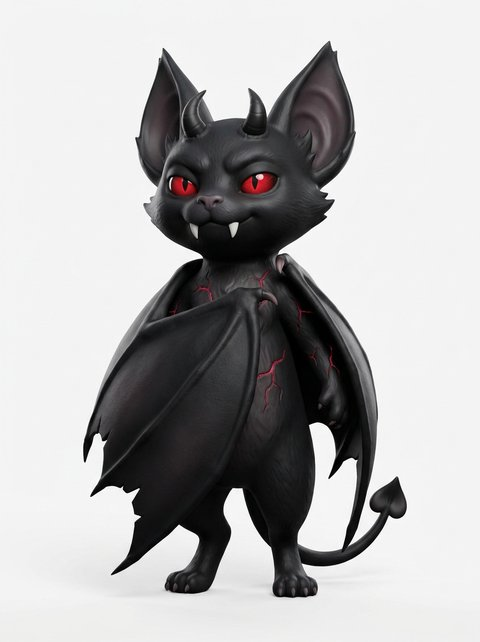
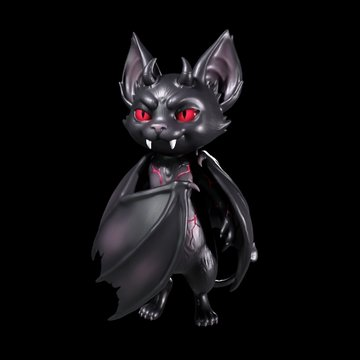
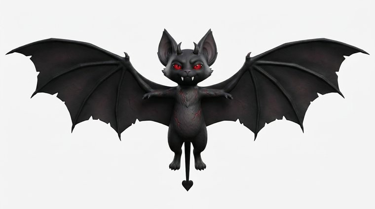
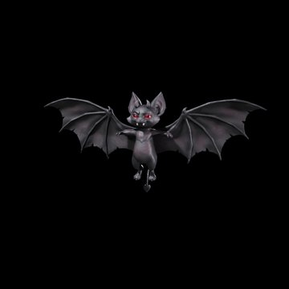

# Como o Ryuk foi feito

Um projeto de pai e filha, num domingo à tarde (18/10/2026).

## 1. A Isa inventou o personagem

A Isa conversou com o ChatGPT até o Ryuk ficar do jeito dela: um morceguinho vampiro-demônio do
tamanho de um gato, fofo e assustador ao mesmo tempo. No fim pediu um prompt para o pai gerar em 3D:

> A full-body stylized 3D character named Ryuk, a small gothic vampire bat demon about the size of a
> domestic cat. […] very long pointed ears, glowing crimson red eyes, two small curved black demon
> horns resembling a tiny crown, […] two oversized white vampire fangs visible even with his mouth
> closed. […] Enormous black leathery bat wings folded around his body like a gothic vampire cloak
> […] A long thin tail ending in an inverted heart-shaped tip. Glowing crimson supernatural cracks
> across his black body. […]

<p>
  
  
</p>

## 2. Imagem → 3D na Meshy

Tudo pela API da [Meshy](https://www.meshy.ai):

| Passo | Endpoint | Créditos |
|---|---|---|
| Imagem de referência a partir do prompt da Isa | `text-to-image` (`nano-banana-pro`) | 9 |
| Modelo 3D com textura PBR | `image-to-3d` (`latest`) | 30 |
| Mesmo personagem, agora voando de asas abertas | `image-to-image` (a partir da 1ª imagem) | 9 |
| Modelo 3D voando | `image-to-3d` | 30 |

Gerar a **imagem** antes do 3D foi o truque: a Isa aprovou o visual antes de gastar crédito, e a
Meshy acerta mais com imagem de frente, fundo branco e silhueta limpa do que com texto.

<p>
  
  
</p>

## 3. Do modelo pesado ao celular

Os modelos da Meshy vêm pesados (o primeiro tinha 577 mil triângulos e 21 MB; o voando, 15 MB) — travam celular. Uma linha resolveu:

```bash
npx @gltf-transform/cli optimize ryuk-voando.glb web/ryuk-voando.glb \
  --compress false --texture-compress webp --texture-size 1024 \
  --simplify-ratio 0.05 --simplify-error 0.002
```

Resultado: ~17 mil triângulos, 630 KB, texturas WebP 1024 px.

## 4. Fazer o Ryuk bater as asas

O modelo é uma malha só, sem esqueleto — então o bater de asas acontece no **vertex shader**,
injetado no material do three.js com `onBeforeCompile`:

- tudo que está além do **ombro** (15% da meia-envergadura) gira em torno do eixo do corpo;
- da metade da asa para fora, um segundo giro no **cotovelo**, atrasado — a ponta chicoteia como
  asa de morcego de verdade;
- as normais giram junto, para a luz acompanhar;
- o corpo sobe um pouco a cada batida para baixo, e a frequência acompanha a velocidade do jogo.

No jogo o Ryuk voa deitado, de costas para a câmera, inclina a asa de dentro nas curvas e empina
ao subir. No menu ele paira de frente.

## 5. As bolsas de sangue

Começaram como "almas" (um icosaedro vermelho). Virou bolsa de sangue — afinal, é um vampiro.
Ela é montada no código: retângulo arredondado extrudado com chanfro (o "estufado"), etiqueta
**A+** desenhada num `canvas`, aba e saídas de plástico no topo, e um brilho vermelho em sprite.

## 6. Jogo, ranking e app

- **three.js 0.160** vendorizado em `web/vendor/` (sem CDN: o app abre offline);
- 8 fases com 3 estrelas cada e um **Modo Sem Fim** que acelera e ganha obstáculos com a distância;
- ranking com **apelido único** e servidor de ~250 linhas em Python puro + SQLite ([API](API.md));
- **PWA**: manifesto, ícone com o rosto do Ryuk e service worker — instala no Android como app;
- publicado atrás de um Cloudflare Tunnel ([deploy](DEPLOY.md)).
